# wkbai

> **wkbai is an independent fan project. It is in no way affiliated with, endorsed by or connected
> to Black Cactus, the makers, publishers or rights holders of Warrior Kings and Warrior Kings:
> Battles, nor to wkbre2 or its author AdrienTD.** Warrior Kings is a trademark of its owners.

> **wkbai is a fork of [AdrienTD/wkbre2](https://github.com/AdrienTD/wkbre2)** (renamed on
> 2026-10-31, as it has grown far from it), the open-source engine
> reimplementation of Warrior Kings and Warrior Kings: Battles (Black Cactus, 2002/2003).
> This fork is developed **with AI assistance (Claude) and reverse engineering of the original game**.
> The original executable is analysed (Ghidra, disassembly, Direct3D call traces, side-by-side captures)
> to find out how the original renders and behaves, and the engine is then changed to match it or to improve on it.
> All credit for wkbre2 itself goes to AdrienTD and its contributors.
>
> The work happens on the `modernization` branch. No code or assets of the original game are included:
> you need your own copy of the game.

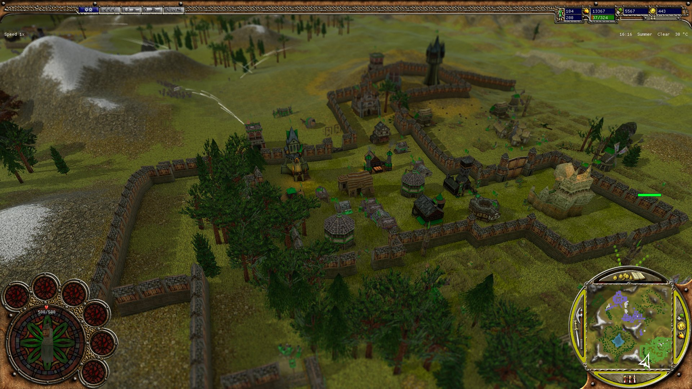

*A walled town from the usual RTS camera, with the original's interface: volumetric clouds, PBR grass, real shadows, and the HD Armoury, Blacksmith, Bank and Black Mass among the original buildings.*

## Gallery

The camera is not tied to the RTS view: it can come down to the ground, where the new renderer shows what it does close up. Only the HD models already accepted are shown; the other buildings are the originals.

| | |
|---|---|
| 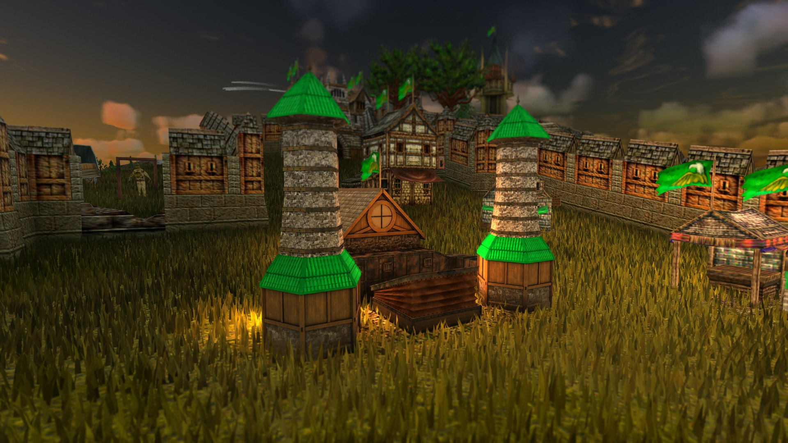 | 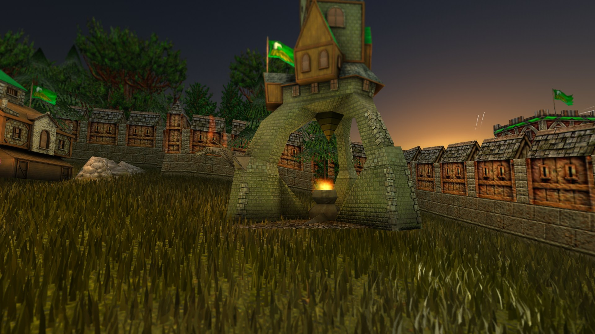 |
| *The HD Blacksmith at sunset: rebuilt on the original's measured shape, PBR materials with weathering, parallax relief, forge smoke.* | *The HD Black Mass at dusk, its fire lighting the arch.* |
| 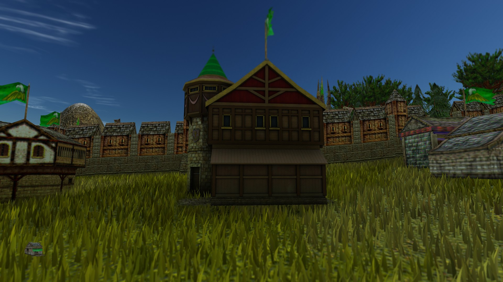 | 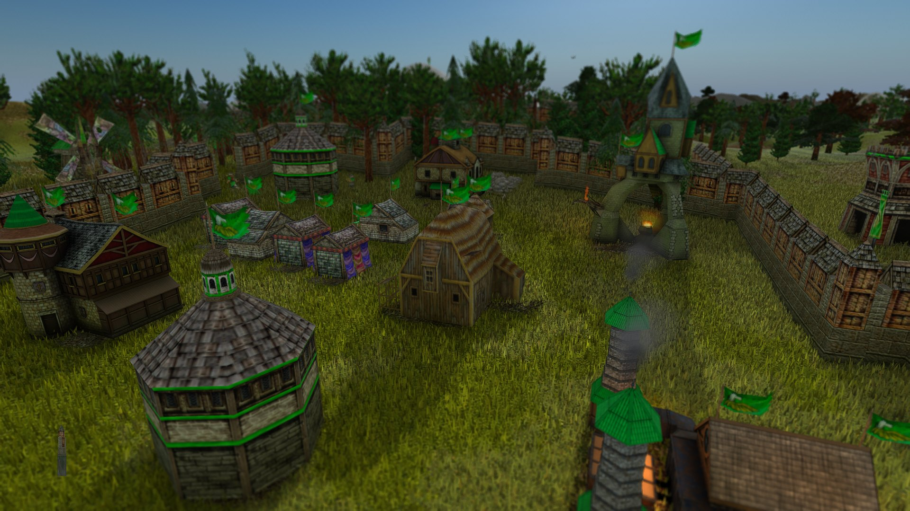 |
| *The HD Armoury in the afternoon light.* | *Over the roofs: chimney smoke, flags in the wind, the walls.* |
| 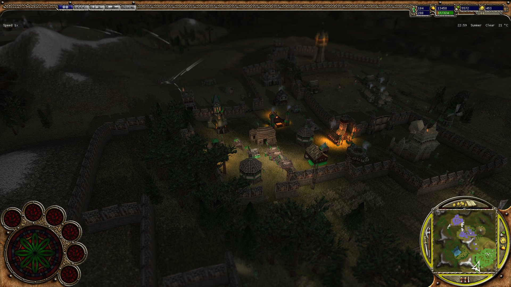 | 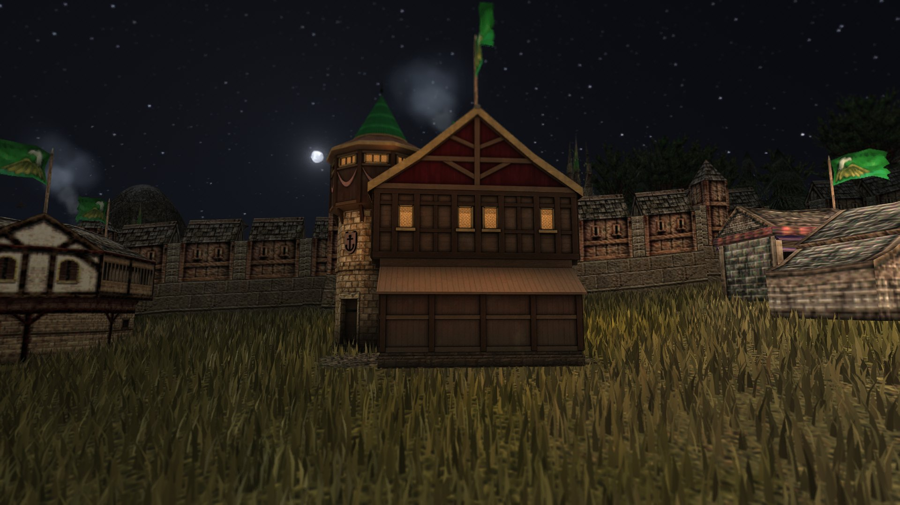 |
| *Night: lit windows, lamps and fires light the town (dynamic GI).* | *A full moon: its phase sets how bright the night is.* |
| 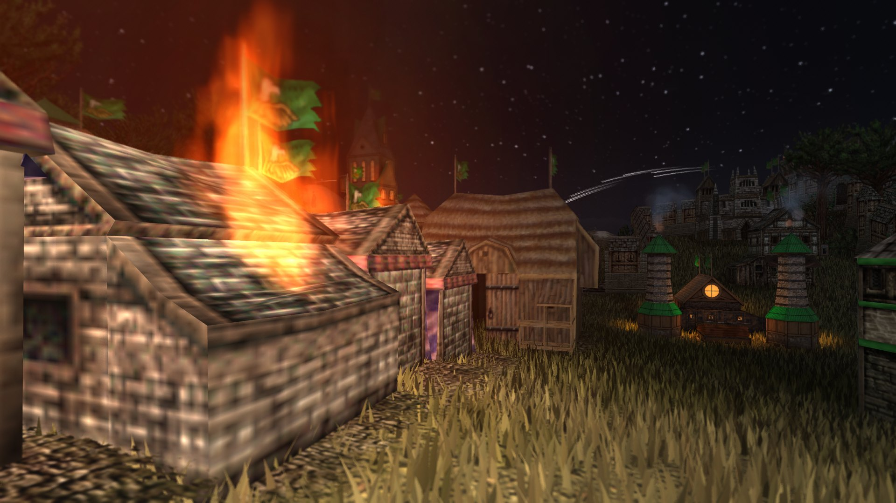 | 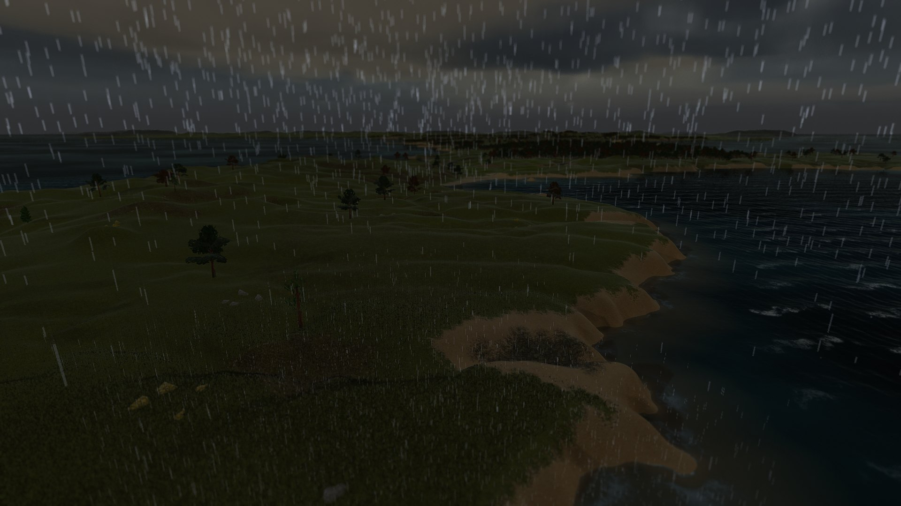 |
| *Procedural fire, with fire light on everything around it.* | *A thunderstorm over the Cornish coast: rain over the whole view.* |
| 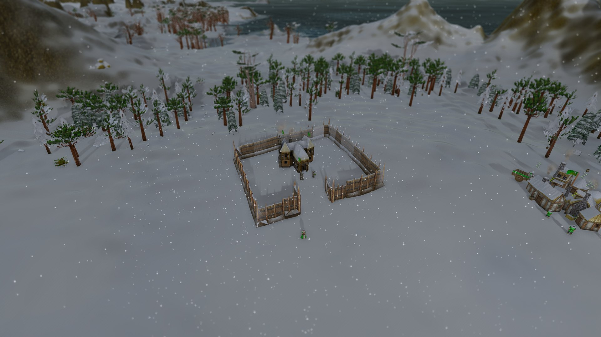 | 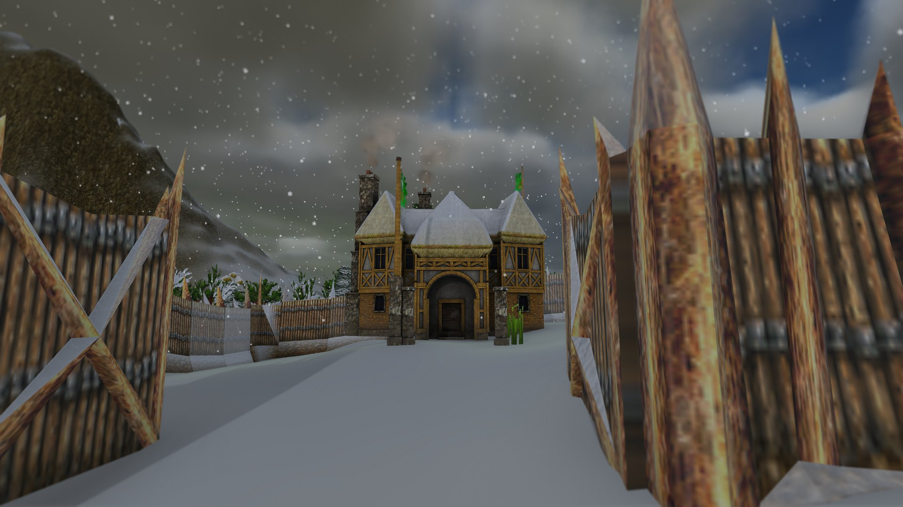 |
| *Deep winter: snow cover on the ground, the trees and the roofs.* | *The HD Manor in falling snow.* |
| 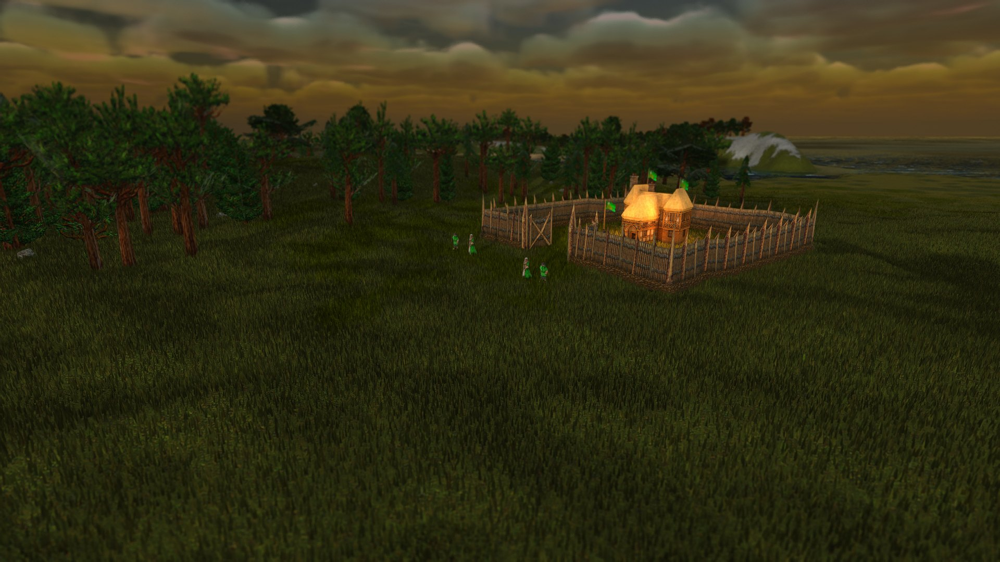 | 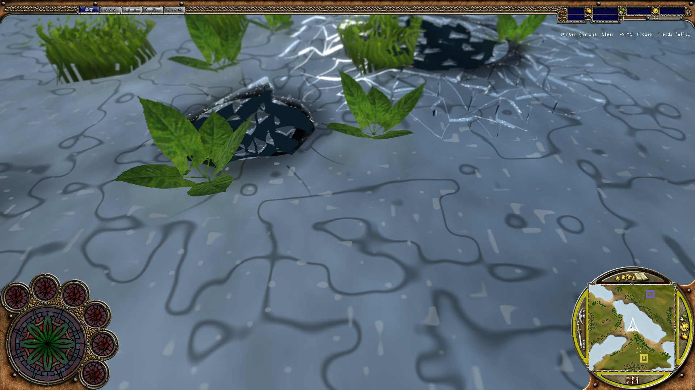 |
| *Sunset under the physical sky.* | *Artillery breaks the ice; units fall in, and the holes refreeze.* |
| 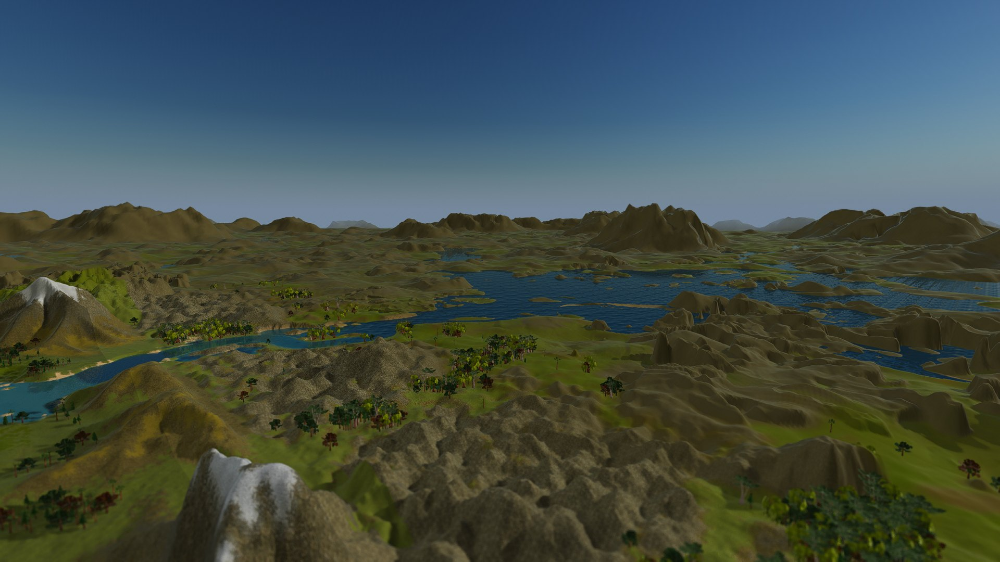 | 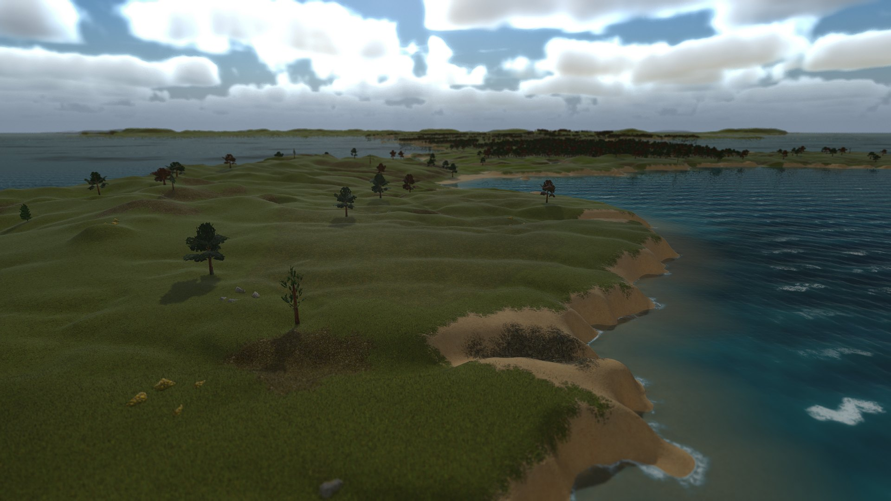 |
| *Extend map: the land goes on past the map's edge, out to the horizon.* | *Cornwall, one of 18 Great Britain maps made from OS Terrain 50.* |
| 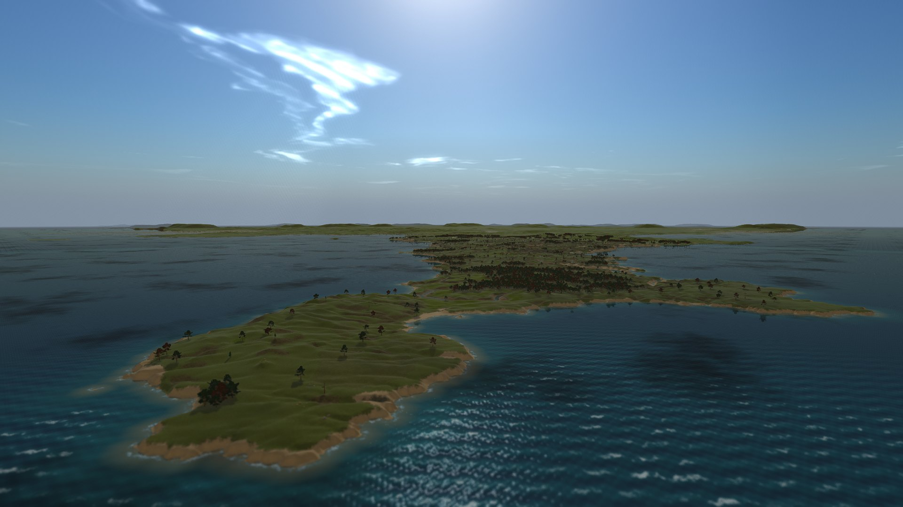 | |
| *The ocean water around Cornwall's islands.* | |

## What wkbai adds

### Graphics

wkbai draws with [Diligent Engine](https://github.com/DiligentGraphics/DiligentCore) on **Direct3D 12 or Vulkan**. The *Original* settings look like the original game (its lighting, shadows, sky, fog and water, found by reverse engineering); everything below is optional, with its own setting.

- **HD models:** glTF replacements of the original models, loaded as overrides from a mod or the user folder, with team colours, emblems, smoke and blood-drip points, animation, parallax occlusion mapping and damage states (Damaged, Derelict, Ruined). A set of hand-built HD buildings is in the works (in its own repository); the screenshots show only the ones already accepted.
- **Lighting:** per-pixel PBR lighting of the models with GGX highlights, reflections (screen-space, and ray-traced at Ultra), sky light and **dynamic global illumination**: light bounced from the ground and the buildings, and at Ultra the light of lit windows, fires and lamps from the models' emissive maps.
- **Shadows:** sun shadow maps for every unit and building, **ray-traced shadows** (buildings, trees with their leaves, animated units), contact shadows and cloud shadows.
- **Sky:** a physical sky with sunrises and sunsets, **volumetric clouds** (cumulus, cumulonimbus with anvils, cirrus, lenticulars, stratus decks; each weather its own), light shafts and multiple scattering.
- **Day and night:** the sun and the moon move; the moon shows its phase, lit from the sun's side, and its phase sets how bright the night is.
- **Weather drawn:** rain and snow, snow cover on the ground, roofs and models, footprints, wet ground and floods, frozen rivers and waterfalls, autumn leaves, dry summer grass, rainbows, heat shimmer and chimney smoke.
- **Water** in eight levels, from the original's texture to tessellated ocean waves with crest foam and surf; rivers that flow downhill (also on slopes, with rapids and falls), waterfalls, and **ice that breaks** where artillery hits it.
- **Fire:** procedural flames with glow, smoke, heat shimmer and fire light on everything around.
- **Trees and grass:** the forest is drawn and culled on the GPU (30,000 trees: 50 ms of CPU per frame, were 150-200 ms), trees and grass bend in the wind in gusts, and their shadows sway with them. PBR grass blends across tile edges.
- **Extend map:** the land goes on past the edge of the playable map (seas, ranges, rivers, forests and weather), out to about 30 km, cached on disk.
- **Terrain:** tessellation, PBR material maps for the ground (normal, ORM and height maps from texture packs) with **parallax occlusion mapping** and self-shadowed relief, ground Fresnel from the live sky.
- **Parallax occlusion mapping on models**, with depth sliders for the models and the ground; stained-glass refraction.
- **Post-processing:** ambient occlusion, bloom, FXAA, TAA, **FSR 3.1** anti-aliasing and upscaling (or FSR 1), tilt-shift, motion blur, colour grading.
- **Formats:** glTF 2.0 (import as overrides, export of the originals), DDS and KTX2 textures with BC7.

### Simulation

All of these are game settings in the lobby, off by default; with them off, games play as in the original.

- **Day and night:** night sight, peasants who sleep at night, colder nights.
- **Seasons and weather:** ten weathers, temperature (freezing, thirst, shelter), floods and droughts, snow and ice to walk on, fields lying fallow in winter, wildfires; lightning sets buildings on fire, rain puts fires out.
- **Wind:** fans fires downwind, chills, and speeds or slows boats; a wind gauge on the HUD.
- **River currents** carry units along and make them swim; war machines sink.
- **Breaking ice:** units fall in, swim out or drown, and the kill goes to whoever broke the ice.

### AI

- **The ministry AI:** an AI made of ministries (intelligence through the fog of war, a strategist with a personality, war and generals, diplomacy with grudges, economy, builders, research), with difficulty settings for its vision, reaction and generals.
- **AI at sea:** every AI builds docks and ships, ferries its armies across the water, lands and attacks.
- **Lua AIs:** one per slot, moddable, with the bundled Advanced AI; AIs that adapt to the weather.
- **The original's Kingmaker AI** with its stalls fixed, checked against the original by differential tests on its saves.

### Maps and editing

- **18 Great Britain maps** made from OS Terrain 50, with the real woods (about 20,000 trees a map) and rivers, and campaign provinces as skirmish maps.
- **wkbai's own map format** (`.wkbai` folders), a terrain generator (heightmap and elevation import, ground materials by rule), compiled in the background, and import and export of the original's maps.
- **Map editor** (Map Editor in the main menu): heights, texture painting, lakes, objects, players, zones, scripts, new maps of any size, undo, a check, and save-and-play.

### Interface

- **In-game help:** 464 pages, opened with F1, Shift+F1 or Alt+right-click > Help.
- **Options** for every setting, with a Default button per Graphics page, **rebindable keys**, display modes, high-DPI and interface size; ImGui windows in Warrior Kings' colours.
- **The original's windows** that wkbre2 lacked: diplomacy, the Tavern, tributes, Valhalla armies, disguises, minimap alerts, formations; the original's hot keys and the Patrol order.
- **Statistics (F6), the timeline (F7) and a chronicle** with each unit's name, age, kills and heroes.
- **Recordings and a replay viewer** (0.5x to 16x), a loading screen with real progress, headphone 3D sound and reverb.
- **Multiplayer:** matchmaking (local, Nakama, EOS), an AI that takes over for a player who leaves, joining running games, spectators, passwords and mod checks.

### Performance

- A **10,000-unit battle** fits in the 20 ms simulation step; 10,000 attack orders take 0.14 s (were 2.8 s).
- Path finding on worker threads and with flow fields: a 200-unit order across the map takes 18 ms (was 678 ms).
- A six-AI game still runs at full speed after 30 minutes.
- 2,524 models load in about 5 s (were 30-46 s); a shader cache halves the start-up time.
- A GPU memory budget, block-compressed textures on the GPU, and per-pass GPU and CPU timings (Ctrl+F12).

### Modding and tools

- A **layered file system** with the original's archive rules, mod folders with `mod.json`, a Mods menu, hot reload, and overrides for models, textures, scripts and the Lua interface.
- **Agent control:** a local socket, an MCP server and a Python client to drive the game, for AI evaluation.
- A **versioned save format**, a headless test suite, a Tracy profiler client and a benchmark mode.

### In the works (on branches, not in `modernization` yet)

Generated ground transitions, lockstep multiplayer, and more HD models.

## Status

wkbai follows an 18-phase plan. Phases 0-15 are done (setup, formats, reverse engineering, engine, renderer, gameplay parity, performance, replays, multiplayer, day and night with seasons and weather, map editor, modding, the AI overhaul, release, agent control and the original's remaining features). Phase 16 (the ministry AI) is waiting for its play test, and phase 17 (map and campaign authoring) is under way.

## Usage

- Build the `modernization` branch (see below). Windows only for now: the Diligent renderer still needs a Linux window path.
- Create **wkconfig.json** next to the executable, or edit it if it is already there:
  - **gamePath:** the folder where the game is installed, the one that contains data.bcp. Write each backslash twice (`\\`).
  - **gameVersion:** 1 for **Warrior Kings**, 2 for **Warrior Kings: Battles**.
  - **diligentBackend:** optionally, `"d3d12"` (the default) or `"vulkan"`.
- Launch **wkbai.exe**. Press **F10** in a game for the Options screen and **F1** for the help. Settings, saves and mods go to `%APPDATA%\wkbai` (copied from `%APPDATA%\wkbre2` the first time).

**Note:** if the program closes at startup without an error, check **wkconfig.json** for syntax errors (missing commas, quotes or braces).

## Compiling

You need:
- Visual Studio 2022 or later, with C++20;
- [CMake](https://cmake.org/);
- [vcpkg](https://vcpkg.io).

The dependencies come from the `vcpkg.json` manifest. Diligent Engine is fetched by CMake.

```
cmake -S . -B build -A x64 -DCMAKE_TOOLCHAIN_FILE=<vcpkg root>/scripts/buildsystems/vcpkg.cmake -DVCPKG_TARGET_TRIPLET=x64-windows
cmake --build build --config RelWithDebInfo
```

---

## About wkbre2 (from the upstream README)

wkbre2 is an engine recreation: it loads the original game's own asset and script files. The original
game uses a set of text-based script files, the **game set**, that define all units, buildings, game mechanics,
commands and orders. wkbre2 interprets this game set, much as ScummVM interprets the scripts of adventure games.
This way it supports nearly all of the game's mechanics without reimplementing them from scratch.

Like the original engine, wkbre2 has a **client-server architecture**:
- the **server** runs all game logic and holds the state of the game;
- each **client** shows the player a view of that state and sends the player's commands to the server.

This architecture is what makes multiplayer possible. In single player, the server and the client run on
separate threads, so the game logic and the rendering don't slow each other down.

See [AdrienTD/wkbre2](https://github.com/AdrienTD/wkbre2) for the original project, its history and its releases.

## License

GPL-3.0, as upstream: see [LICENSE](LICENSE). wkbai is a modified version of wkbre2, changed
since 2026-10-25 (the git history has every change).

Some parts are under other GPL-compatible licences (Dear ImGui, the AMD FidelityFX shaders, bcdec,
a hash function and others), and the libraries wkbai is built with have their own:
[THIRD-PARTY-NOTICES.md](THIRD-PARTY-NOTICES.md) lists each one, the files or binaries it covers
and where its full text is.
