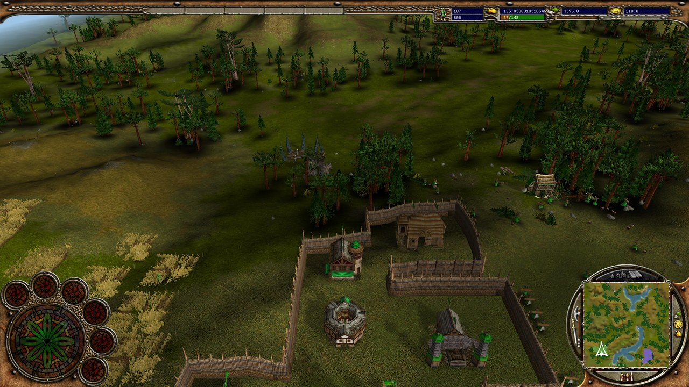
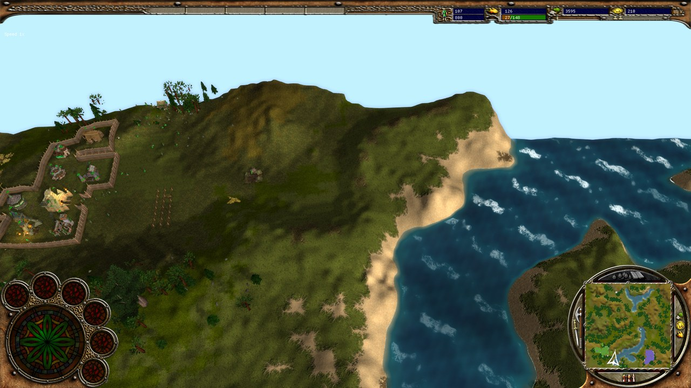

# wkbai

> **wkbai is an independent fan project. It is in no way affiliated with, endorsed by or connected
> to Black Cactus, the makers, publishers or rights holders of Warrior Kings and Warrior Kings:
> Battles, nor to wkbre2 or its author AdrienTD.** Warrior Kings is a trademark of its owners.

> **wkbai is a fork of [AdrienTD/wkbre2](https://github.com/AdrienTD/wkbre2)** (renamed on
> 2026-10-31, as it has grown far from it), the open-source engine
> reimplementation of Warrior Kings and Warrior Kings: Battles (Black Cactus, 2002/2003).
> This fork is developed **with AI assistance (Claude) and reverse engineering of the original game**.
> The original executable is analysed (Ghidra, disassembly, Direct3D call traces, side-by-side captures)
> to find out how the original renders and behaves, and wkbre2 is then changed to match it or to improve on it.
> All credit for wkbre2 itself goes to AdrienTD and its contributors.
>
> The work happens on the `modernization` branch. No code or assets of the original game are included:
> you need your own copy of the game.



*The stress-test scene: a campaign save with about 4,850 objects in view, drawn with Direct3D 12.*



## What this fork changes

Compared with upstream wkbre2:

- **Renderer**
  - [Diligent Engine](https://github.com/DiligentGraphics/DiligentCore) with **Direct3D 12 and Vulkan**. The old Direct3D 9/11 and OpenGL renderers are gone, and a null renderer remains for tests.
- **Faithful look, from reverse engineering the original**
  - **Lighting:** the original's model and terrain lighting.
  - **Shadows:** the original's static building shadows, scrolling cloud shadows and unit blob shadows.
  - **Sky and fog:** the sky cube with its horizon fade, the fog distances, and an edge fog that hides the map border.
  - **Water:** a water surface with scrolling texture layers, ripples and a sun glint.
  - **Models:** `SHEAR_MODEL` models adapt to sloped ground.
- **Gameplay and interface**
  - **Minimap:** player dots, the camera arrow and the four mode buttons.
  - **Camera:** limits on pitch and height, and Shift to scroll faster.
  - **Order flags:** a flag marks the target of an order.
  - **Deleting:** the Delete key destroys the selected object, with its death animation.
- **Performance**
  - **Terrain:** drawn in chunks, with water in a single draw call.
  - **Loading:** models are prepared at level start, so new parts of the map no longer stutter into view.
  - **Shadows on the GPU:** blob shadows are drawn on the GPU.
  - **Scene building:** cheaper per-object work.
  - **Result:** the stress test above runs in about 4.3 ms per frame (was 8.0 ms).
- **Engine**
  - **Toolchain:** x64, C++20 and SDL 3, built with a vcpkg manifest and Windows CI.
  - **Profiling:** a Tracy profiler client and a benchmark mode with frame-time reports.
- **Mods**
  - **File system:** a layered file system that follows the original's archive rules (the newest timestamp wins).
  - **Mod folders:** mod folders with `mod.json`, and a Mods menu to enable them and change their load order.
- **Robustness**
  - **Scripts:** the game-set parser stays in sync on unimplemented keywords.
  - **Missing files:** broken mod combinations no longer crash.
- **AI**
  - **Kingmaker AI:** stalls fixed (deleted objects, work orders, farms at the map's corner, an upgrade waited for forever), towns get their walls and gatehouse, and the armies' `FORCE_BALANCE` works.
  - **Aggressive AI** (skirmish setting, on by default): at most 80 peasants, barracks first, armies launched as soon as they can be paid, food-only fighters when wood or gold is short, and all of an AI's armies sent against its nearest enemy (an AI destroyed per 25-minute 8-player game, none before).
  - **Diplomacy:** AIs' diplomatic offers reach the players offered to, whose scripts answer them.
  - **Headless AI-vs-AI test** (test 30) with a census per minute, and a tournament tool over several seeds.
- **Pathfinding:** units keep to the terrain their passability fields allow, as the original's per-tile test does (no walking over water, river beds or mountains).
- **Graphics options** (enhanced renderer)
  - **Post-processing:** ambient occlusion and bloom.
  - **Real unit shadows** from the sun's shadow map, and wall shadows.
  - **Blended terrain:** materials blended at the tile corners, each from several of its tiles, triplanar on cliffs (off by default).
  - **Model highlights:** per-pixel lighting with GGX sun highlights, light from the sky box's colours, and override packs (`<texture>_normal`, `<texture>_orm`) for modders (off by default).
- **Formats:** glTF 2.0 models (import as overrides, export with `"exportGltf"`), DDS textures (BC1-BC5, BC7) and KTX2 (RGBA8, BC1-BC5, BC7; BC7 uploaded compressed).
- **Map editor** (F8): heights, texture painting, lakes, objects, the players' resources and diplomacy, terrain zones, a new blank map, undo, a new minimap on saving, a check (missing start cameras, players that can't be reached by land), and save-and-play.
- **Settings:** an options menu, and a settings window on **F10** for the view distance, fog, field of view, colour grading, shadows, water and camera speed.

## Status

The project follows a ten-phase plan, from setup (phase 0) to release (phase 9). **Current phase:** 4, modern renderer. **Next:** Phase 8: focused attacks measured, then army retreat and regrouping; Phase 2: pathfinding search and combat RE, a menu-driven differential harness; Phase 6: triggers, the new map format; Phase 4: faithful mode, PBR override packs.

| Phase | Progress | Done | Open |
|---|---|---|---|
| 0 Setup & quick wins | 7/7 | Git repo, Pristine SHA-256 hashes, Toolchain installed, REA + Ghidra connected, DXVK quick win, Baseline perf captures, Identify version.dll | — |
| 1 Asset & format knowledge | 4/4 | BCP reader/extractor, Format specs, Round-trip tests, Asset inventory | — |
| 2 Binary RE (ongoing) | 5/7 | Exe in Ghidra via REA, RTTI class hierarchy, Keyword diff vs wkbre2, Original file system (BCP load rule), Renderer interface signatures | Pathfinding/combat/AI RE (in progress), Differential test harness |
| 3 Engine foundation (wkbre2) | 6/6 | Fork & build wkbre2, Run against game data, CI + round-trip tests, x64 · C++20 · SDL3, Layered VFS (BCP → mods), RHI decision + Tracy | — |
| **4 Modern renderer** (current) | 4/8 | Diligent integration (D3D12/Vulkan), GPU skinning/instancing/culling, glTF / KTX2, Resolution & UI scaling | Faithful mode (in progress), PBR materials (in progress), Lighting & effects (in progress), Splat-map terrain (in progress) |
| 5 Gameplay parity | 7/8 | Evaluate WKB Plus patch, Minimap + DISPLAY_ON_MINIMAP, Main menu, Settings, in-game Esc menu, Play-test bugs: stampdown overlap, formations, guard, range circles, rally flag, Deterministic simulation, Fix original engine bugs, Population limit up to 10,000 | Close script/order gaps (in progress) |
| 6 Map editor | 1/3 | Undo / play-test / validation | Port wkbre editor features (in progress), Export original + new format (in progress) |
| 7 Modding | 4/4 | Mod package format, Asset/script/Lua overrides, Hot reload + mod manager, Modding docs | — |
| 8 AI overhaul | 2/4 | RE original AI, Headless AI-vs-AI testing | Strategic layer (in progress), Operational/tactical layers (in progress) |
| 9 Release | 1/1 | Launcher + packaging | — |

**Play-testing:** the issues found in three play tests are fixed or listed in the reverse-engineering repository's notes (building placement, formations, guarding, range circles, rally flags, AI armies and walls, particles, wall shadows, the HUD and the settings steppers).

## Usage

- Build the `modernization` branch (see below). Windows only for now: the Diligent renderer still needs a Linux window path.
- Create **wkconfig.json** next to the executable, or edit it if it is already there:
  - **gamePath:** the folder where the game is installed, the one that contains data.bcp. Write each backslash twice (`\\`).
  - **gameVersion:** 1 for **Warrior Kings**, 2 for **Warrior Kings: Battles**.
  - **diligentBackend:** optionally, `"d3d12"` (the default) or `"vulkan"`.
- Launch wkbre2. Press **F10** in game for the settings window.

**Note:** if the program closes at startup without an error, check **wkconfig.json** for syntax errors (missing commas, quotes or braces).

## Compiling

You need:
- Visual Studio 2022 or later, with C++20;
- [CMake](https://cmake.org/);
- [vcpkg](https://vcpkg.io).

The dependencies come from the `vcpkg.json` manifest. Diligent Engine is fetched by CMake.

```
cmake -S . -B build -A x64 -DCMAKE_TOOLCHAIN_FILE=<vcpkg root>/scripts/buildsystems/vcpkg.cmake -DVCPKG_TARGET_TRIPLET=x64-windows
cmake --build build --config RelWithDebInfo
```

---

## About wkbre2 (from the upstream README)

wkbre2 is an engine recreation: it loads the original game's own asset and script files. The original
game uses a set of text-based script files, the **game set**, that define all units, buildings, game mechanics,
commands and orders. wkbre2 interprets this game set, much as ScummVM interprets the scripts of adventure games.
This way it supports nearly all of the game's mechanics without reimplementing them from scratch.

Like the original engine, wkbre2 has a **client-server architecture**:
- the **server** runs all game logic and holds the state of the game;
- each **client** shows the player a view of that state and sends the player's commands to the server.

This architecture is what makes multiplayer possible. In single player, the server and the client run on
separate threads, so the game logic and the rendering don't slow each other down.

See [AdrienTD/wkbre2](https://github.com/AdrienTD/wkbre2) for the original project, its history and its releases.

## License

GPL-3.0, as upstream: see [LICENSE](LICENSE).
