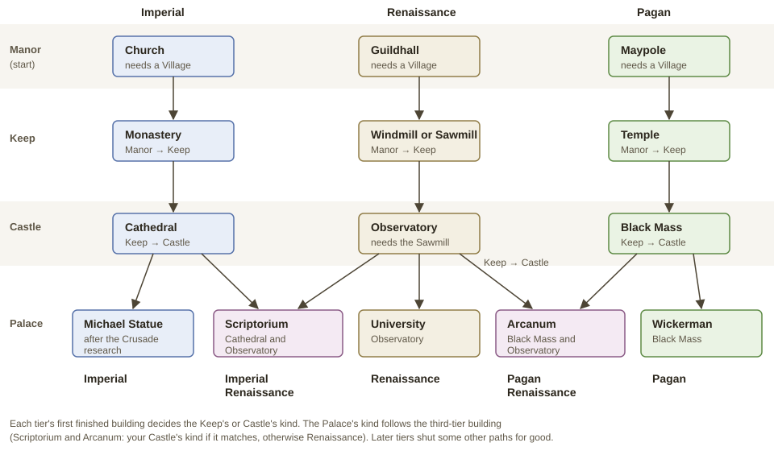

# Alignment and the five paths

You don't choose a side at the start. Your **alignment** grows out of what you build. There are three ways of life, and each has its own buildings, units and powers:

- **Imperial**: the church, monks, knights and the Archangel. The game set calls it *Celestial*.
- **Renaissance**: mills, science, gunpowder and machines. The game set calls it *Technological*.
- **Pagan**: the old gods, druids, beasts and demons.

Your headquarters shows the path you are on. It starts as a [Manor](../buildings/manor.md) and is rebuilt three times, each time as the Imperial, Renaissance or Pagan version of a **Keep**, a **Castle** and finally a **Palace**.

## The ladder

| Step | Imperial | Renaissance | Pagan |
|---|---|---|---|
| Start, after a [Village](../buildings/village-wood.md) | [Church](../buildings/church-stone.md) | [Guildhall](../buildings/guildhall-stone.md) | [Maypole](../buildings/maypole.md) |
| Manor → Keep | [Monastery](../buildings/monastery.md) | [Windmill](../buildings/windmill.md) or [Sawmill](../buildings/sawmill.md) | [Temple](../buildings/temple.md) |
| Keep → Castle | [Cathedral](../buildings/cathedral-stone.md) | [Observatory](../buildings/observatory.md) (needs the Sawmill) | [Black Mass](../buildings/black-mass.md) |
| Castle → Palace | [Michael Statue](../buildings/michael-statue.md) (after the *Crusade* research at the Cathedral) | [University](../buildings/university.md) | [Wickerman](../buildings/wickerman.md) |

- **The first one decides.** The first second-step building you finish turns the Manor into its kind of Keep; the first third-step building turns the Keep into its kind of Castle. Building another path's building later doesn't change the Keep or Castle again.
- **Mixing is allowed at first.** You can have a Monastery and a Temple, or a Cathedral and an Observatory. The fourth step is where the paths close.

## The five paths

The two mixed Palaces come from combining an Observatory with another path's third step:

| Path | Palace building | Needs | Palace you get |
|---|---|---|---|
| **Imperial** | [Michael Statue](../buildings/michael-statue.md) | Cathedral, Crusade | [Palace (Imperial)](../buildings/palace-celestial.md) |
| **Imperial Renaissance** | [Scriptorium](../buildings/scriptorium.md) | Cathedral and Observatory | Imperial if your Castle is Imperial, else Renaissance |
| **Renaissance** | [University](../buildings/university.md) | Observatory | [Palace (Renaissance)](../buildings/palace-tech.md) |
| **Pagan Renaissance** | [Arcanum](../buildings/arcanum.md) | Black Mass and Observatory | Pagan if your Castle is Pagan, else Renaissance |
| **Pagan** | [Wickerman](../buildings/wickerman.md) | Black Mass | [Palace (Pagan)](../buildings/palace-pagan.md) |

## What closes

Building one path's buildings takes others away, some for good, some only while the building stands:

- **Cathedral or Black Mass:** no University.
- **Observatory:** no Michael Statue or Inquisitor; no Celestial Archers, Celestial Knights, Men at Arms or War Elephants; no Pagan Pikemen. No Wickerman while it stands.
- **Michael Statue:** no Scriptorium, University, Observatory or Bank; no Mounted Hand Gunners.
- **University:** no Michael Statue, Scriptorium, Arcanum, Wickerman, Cathedral, Black Mass, stone fort or Hell's Barracks; no Mounted Hand Gunners, Rock Throwers or Infernal Engines.
- **Scriptorium:** no Michael Statue, Arcanum, University or Wickerman; no Rocket Launchers.
- **Arcanum:** no Michael Statue, Scriptorium, University or Wickerman; no Pagan Pikemen or Rocket Launchers.
- **Cathedral and Black Mass** also shut out the Rocket Launcher and the Bombard Boat.

A button whose building is ruled out shows its ghost icon with the reason in its tooltip.

## What each step brings

Each step opens units, research and powers of its own; the building pages list them. A few examples:

- The Monastery, Temple and Sawmill each open the second tier of armour and weapons; the University the third ([training and research](upgrades-and-research.md#armour-and-weapons)).
- The Cathedral opens the Bishop and the Crusade; the Michael Statue the Inquisitor.
- The Temple opens heavy horsemen and mounted bowwomen; the Hall of Warriors Pagan spearwomen and archers.
- The University opens Gunners; the Arcanum the elementals and the Dark Portal.

## In the campaign

In the [Kingmaker campaign](campaign.md) each building also needs enough **Advances** of its kind: Imperial, Renaissance or Pagan. A Monastery, Temple, Windmill or Sawmill needs 1; a Cathedral, Black Mass, Observatory or Bank 2; a University or Wickerman 3. The Scriptorium needs 2 Imperial and 2 Renaissance, the Arcanum 2 Pagan and 2 Renaissance. You earn Advances by conquering provinces. In skirmish and multiplayer they don't apply.

