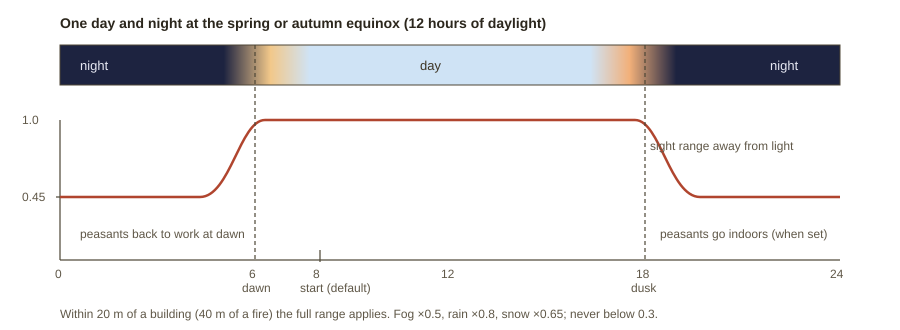

# Day and night

> **wkbai.** Day and night are wkbai's own. The original game is always at noon. They are off unless the lobby's *Seasons & Weather* tab turns them on ([the weather tab](../ui/frontend/skirmish/weather.md)), and the campaign never has them.

## The clock

- **Day length:** a whole day and night lasts 2 to 240 minutes of game time (20 by default).
- **Start hour:** 0 to 23 (8 in the morning by default).
- **The sun** rises in the east and sets in the west, at the height of the map's latitude: 47° north unless the map sets its own ([Sun and latitude](../ui/editor/latitude.md)). Without seasons it stands as at the equinox (12 hours of daylight). With seasons, a summer day is longer (about 16 hours of 24) and a winter day shorter (about 8): with a 20-minute day, about 13 and 7 minutes of daylight.
- **Shadows** follow the sun all day. After dark, lit windows glow in the houses near the camera.
- The HUD shows the time of day ([the top bar](../ui/hud/top-bar.md)).

## Night sight

At night units see less, unless the place they look at is lit:

- **Away from light** a sight range shrinks to **0.45** of its daytime length at midnight, growing back towards dawn.
- **Weather** cuts it further: fog to half, rain to 0.8, snow to 0.65 ([seasons and weather](seasons-weather.md)). It never goes below 0.3.
- **Light:** a target within 20 m of any built building, or within 40 m of a burning one, is seen at the full range.
- **Missile range** isn't shortened: an archer can shoot as far at night, but only at what it sees.
- The fog of war on your screen follows the same rule ([fog of war](fog-of-war.md)).

## The moon

- **Natural** (the default): the moon goes through its phases over a month of 29.5 game days, starting from the phase it had on the first day of the starting season.
- **A fixed phase:** one of the eight phases all game.
- The moon only changes the light: a full moon lights the land, a new moon leaves it dark. It doesn't change sight ranges.

## What night does to play

- **Peasants sleep** indoors at night if that switch is on, and bring nothing in until dawn: see [peasants at night and in winter](peasant-lodging.md).
- **Raids** are easier: enemies see less of what comes, and a sleeping town's fields stand empty.
- **The AI** knows the night: wkbai's AI can hold its waves for the dark or send them then.

