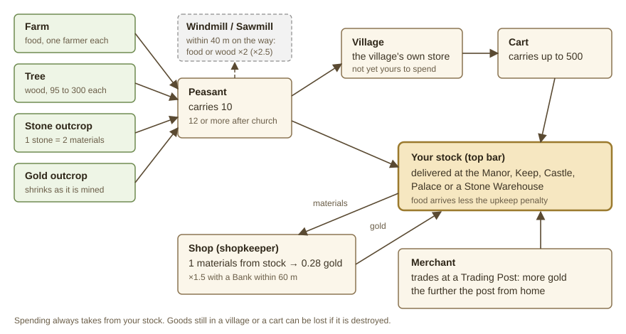

# Resources

The top bar shows three stocks: **food**, **materials** and **gold**. Everything you train, build or research is paid from them. Peasants gather the raw goods from the land and carry them home; only what reaches a storage building counts.

## The four goods

| Good | Where it comes from | Notes |
|---|---|---|
| **Food** | [Farms](../buildings/standard-farm.md), one farmer each | How much a farm yields depends on the ground under it (below). The game set has no fishing or hunting for your stock. |
| **Materials** (wood) | Trees: 95 to 300 wood each | A peasant cuts 1 wood a stroke. A felled tree is gone. |
| **Stone** | Stone outcrops: 10 to 200 stone each | Stone isn't a stock of its own: each stone delivered adds **2 materials**. |
| **Gold** | Gold outcrops (10 to 200 gold), [shops](../buildings/shop-stone.md), [merchants](../units/merchant.md), tribute | An outcrop shrinks as it is mined and vanishes when empty. |

**Starting stock.** The lobby sets it: by default 500 food, 500 materials and 200 gold. *Randomise Resources* (Off, Low, Medium, High; Medium by default) takes away the map's own stone and gold outcrops at the start and scatters new ones: some near each player's Manor and more over the whole map, the more the higher the setting. Off keeps the map's own outcrops. Trees are never changed. (Placing outcrops in your own maps: [the map editor's Objects mode](../ui/editor/objects.md#tips).) In the campaign you start with what your profile carries over ([campaign](campaign.md)).

## Farms and the ground

A farm takes its fertility from the ground it stands on, once, when it is placed:

| Ground | Farm | Food per turn of the hoe |
|---|---|---|
| fertile | Fertile Farm | 1.5 |
| ordinary | Standard Farm | 1 |
| barren | Barren Farm | 0.5 |

Only one peasant works a farm at a time. A farmer also raises your **food support** while he works, which matters more than the food itself: see [food, population and upkeep](population-and-food.md).

## Carrying and delivering

- **Load.** A peasant carries at most **10** of one good, then walks to the nearest place it can deliver to. A peasant who prays at a church carries **12** or more for a while ([peasants and their work](peasants-and-work.md#church-and-maypole)).
- **Where to.**
  - The **Manor** (later Keep, Castle or Palace) and a **[Stone Warehouse](../buildings/warehouse-stone.md)** put the goods straight into your stock.
  - A **[Village](../buildings/village-wood.md)** keeps them in its own store. A [Cart](../units/cart.md) (up to 500) then takes them to the Manor. A new village asks the nearest Manor for a cart when it is finished.
- **Mills on the way.** A farmer who passes a [Windmill](../buildings/windmill.md) within 40 m on his way to deliver doubles his load; a woodcutter does the same at a [Sawmill](../buildings/sawmill.md). The *Advanced Windmill* and *Advanced Sawmill* research raise this to ×2.5.
- **Food loses its upkeep.** Food is reduced on delivery by the share your army eats. See [the upkeep penalty](population-and-food.md#the-upkeep-penalty).

## Gold

- **Mining** gives 1 gold a stroke from a gold outcrop.
- **Shops.** A peasant keeping a shop turns materials into gold: each cycle takes 1 materials from your stock and makes 0.28 gold. With a [Bank](../buildings/bank.md) within 60 m on his way, the gold is worth 1.5 times as much. A shop stops when your materials run out.
- **Trade.** [Merchants](../units/merchant.md) carry goods between a [Trading Post](../buildings/trading-post.md) and your town. The further the post is from where they deliver, the more gold each trip brings.
- **Tribute** from another player arrives at once ([diplomacy](diplomacy.md#tributes)).

## Sacks and losses

- **Sacks.** A village or a cart destroyed with goods inside leaves them on the ground as sacks. Any peasant (or a supply wagon) can pick a sack up and deliver it, yours or the enemy's.
- **Headquarters destroyed.** Your stock is shared between your Manor-type buildings. When an enemy destroys one, you lose your stock divided by (the number of those buildings + 1), and the enemy gains it.

## Where to see it

The top bar shows the three stocks and the food bar; the peasant activity panel over the minimap shows how many peasants do each job. See [the top bar](../ui/hud/top-bar.md) and [peasant activity](../ui/hud/peasant-activity.md).

> **wkbai.** With wkbai's seasons on, fields give nothing in winter, and farmers wintering indoors add a small bonus to wood and gold ([seasons and weather](seasons-weather.md), [peasants at night and in winter](peasant-lodging.md)).
